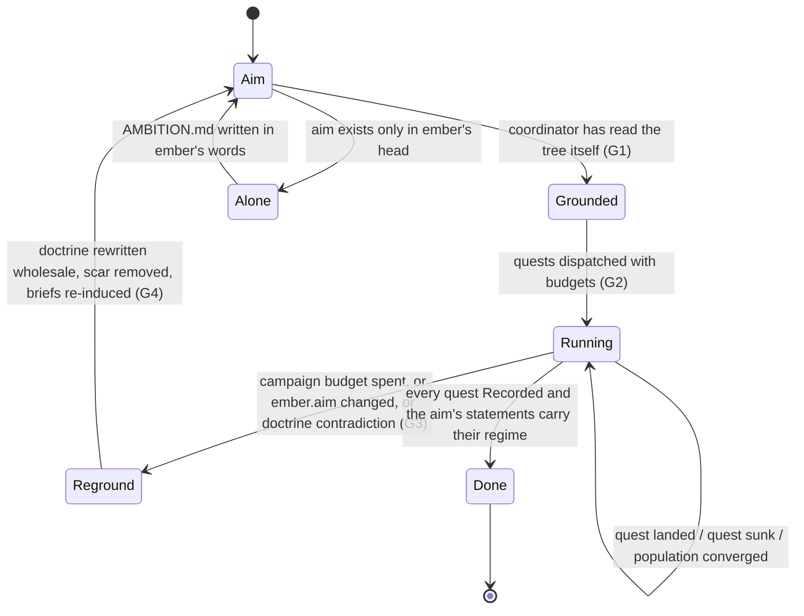

# The development process as a statechart

Written 2026-11-04 from `~/dev/collected-writings/prompts/COHERENCE.md`, the quote-verified
synthesis of every prompt ember typed to an agent across the dregg family. That document found
eight ideas every period returns to and eighteen frustrations that persisted for a year across
every model and harness. A pattern that survives a year of changing agents is a property of the
process, so the process is what gets rebuilt here: as a statechart whose guards are the lints,
whose sinks are the eighteen patterns, and whose only inputs from ember are the three kinds of
event the prompts show ember actually wanted to supply. `DESIGN.md` holds the objects (segment,
artifact, evaluator, ledger) and the executors; this file holds the control flow those objects
move through. `spec/process.json` is the same machine in a form `obb state` and `obb seg` load.

## 0. The invariants, in the words that set them

Every state and guard below serves one of these. Dates are when ember first said it.

1. **A home for AI, and a body to act with.** "if i was a digital entity, where would i want to
   live?" (2026-06-08). Nothing below exists for its own sake.
2. **Lean holds the semantics; everything else is emitted or calls in.** "the rust code is a
   ghost of the lean code which should be considered canonical" (2026-07-09).
3. **Nothing fake; a label is not a fix.** "we never want to do 'honest framing' as a substitute
   for actual work" (2026-05-21).
4. **Proofs are about the real, wired system.** "everything that we have implemented or proved
   about is a wired, live, real part of the living protocol semantics" (2026-06-21).
5. **Working first, then proven.** "the 'silver vision' which is that the semantics&etc of the
   thing make sense /at all/, before we pursue resources into the 'golden vision' of having
   everything algebraically provable" (2026-05-24).
6. **Greenfield forever; nothing deployed is sacred.** "there is no existing anything. in fact,
   your hesitation about doing exactly that is probably why this never got done" (2026-07-28).
7. **The swarm is the unit of work, and the agent that holds the context does the work.** "the
   critic should be an empowered critic-doer, fixing-forward instead of just complaining"
   (2026-07-13).
8. **Houyhnhnm: durable, snapshottable, rewindable, debuggable**, and that applies to the process
   as much as to the system it builds (2026-06-19).

## 1. The three machines

Three machines nest: a **campaign** (one ambition, in ember's words, until it is done or changed)
runs **quests** (one deliverable each) inside **segments** (one transcript each). A quest may
span several segments; a segment may serve several quests. Ember appears in exactly three event
kinds, listed in §4; everything else is the supervisor's.

### 1.1 Campaign

- **Aim** holds one sentence in ember's words plus its silver and golden forms (invariant 5). It
  is a file in the repository (`AMBITION.md`), because "most of the project management is
  entirely in latent space in Claudethought" (2026-07-18) is the pattern this state exists to end.
- **Grounded** means the coordinating agent read the foundation itself: files whole, not greps,
  not a scout's summary (patterns Lost and Summary-Rebuilt). The guard is a cv fact: the
  coordinator's own transcript holds reads of the named files.
- **Reground** is the only place doctrine changes, and it changes by rewrite, never by append
  (pattern Appended). It also removes what the campaign replaced (pattern Scar) and re-induces
  briefs from the transcripts that landed (DESIGN.md §2.10).

### 1.2 Quest

```mermaid
stateDiagram-v2
    [*] --> Grounded
    Grounded --> Scoped: brief states the whole aim and the swarm-hour estimate (Q1)
    Scoped --> Built: the thing runs, on real inputs, in the real tree (Q2)
    Built --> Wired: it is called by, or emitted into, the live system (Q3)
    Wired --> Toothed: a planted failure is refused; tests bite (Q4)
    Toothed --> Landed: on main, named files, old path deleted (Q5)
    Landed --> Claimed: statements carry a regime: decided, certified or attested (Q6)
    Claimed --> Recorded: ledger row, docs for a reader, nothing else (Q7)
    Recorded --> [*]

    Grounded --> Lost
    Grounded --> SummaryRebuilt
    Scoped --> Shrunk
    Scoped --> Miscalibrated
    Built --> Theater
    Built --> Mirror
    Wired --> Label
    Toothed --> Ritual
    Landed --> SideBranched
    Landed --> Stomped
    Landed --> Scar
    Recorded --> Navel
    Recorded --> Appended
    state "any" as Any
    Any --> Stalled
    Any --> EmberGated
    Any --> Slow
    Any --> HarnessLoss
```

Two rules make the quest machine the silver-before-golden order of invariant 5. First, Landed
precedes Claimed: a quest lands when it is built, wired and toothed, with its statements labelled
*attested*; Claimed upgrades the label later, and nothing waits on it. Second, every sink is a
state a lint moves the quest into, not a verdict an agent writes about itself; the quest leaves a
sink only by the transition that fixes it, performed by the agent already holding the context
(invariant 7).

### 1.3 Segment

```mermaid
stateDiagram-v2
    [*] --> Fresh: brief induced from cv, or written as a colleague's note
    Fresh --> Working
    Working --> Working: tool rounds; budget decrements
    Working --> Forgetting: segment length reached; artifacts kept, conversation cleared (S1)
    Forgetting --> Working
    Working --> Pressured: cv doctor shows the window filling (S2)
    Pressured --> Distilled: cv distill --agent-of root; source retired (S3)
    Distilled --> Working
    Working --> Forked: cv splice at message N, two or three continuations (S4)
    Forked --> Working: compare; keep the best by evaluator
    Working --> Handoff: continue-with another model (S5)
    Handoff --> Working
    Working --> Stranded: root died or wait that never wakes
    Stranded --> Working: cv adopt into the live root (S6)
    Working --> Retired: quest Recorded or segment superseded
    Retired --> [*]
```

Direction on handoff is the pass-1 finding on the handoff tax: downshift with the full transcript,
escalate with the prefix compacted and the working tree kept. A fork at large context is refused
(memory: no forks at large context); the segment distills first.

## 2. The guards, as lints over cv and the tree

Every transition above names a guard. Each guard is computable today from one of three sources:
the elaborated Lean environment (the unified instrument of `DESIGN.md` §2.6, classes 1 to 10),
the transcripts (`cv events`, `cv doctor`, `cv deferrals`, `cv lanes`), or the repository (git
and the ledger). None is a question to the agent, and `obb-state` (`0.7.0`) never accepts a
caller-supplied boolean in place of guard evidence: `obb state take` (`Q1`) acquires an exclusive
non-overlapping path lease (`FootprintLeaseConflict`) pinned to trunk `base_sha`; `obb state propose`
(`Q4`) and `obb state land` (`Q5`) verify a SHA-bound `JudgeReceipt` (`TamperedReceipt`,
`FootprintViolation`, `StaleBaseSha` if trunk moved) with an executed red `#tooth`. An emergency
operator bypass (`obb state land --override-operator <who> --override-reason <why>`) records the
merge unconditionally in the ledger with `effective_regime = "AttestedOverride"` and
`merged_ungated = true`, refusing promotion to `Claimed` or `Recorded` as `decided`/`certified`.
Seeded UI fixtures (`obb state seed-obend`, `obb serve --seed-demo`) carry `origin = "demo_seed"`
so demo rows are never counted as live verified transitions.

| guard | computed from | passes when |
|---|---|---|
| G1, Q-Grounded | cv events of the coordinator | the named foundation files appear as whole reads in its own transcript; no Explore agent return stands in for them |
| G2 | ledger | every dispatched quest has a brief, a budget in swarm-hours, a machine, a worktree or main, and an evaluator |
| G3 | ledger, cv deferrals | budget exhausted, or a doctrine file contradicts itself (two rulings on one subject), or ember.aim arrived |
| G4 | git diff of doctrine files | the diff rewrites sections rather than appending; replaced modules are deleted in the same commit |
| Q1 | brief vs aim | the brief's deliverable is the aim's deliverable, not a subset; the estimate is in swarm-hours and cites a comparable from `cv stats` |
| Q2 | tree | the artifact runs on real inputs in the real tree: no simulation, mock, stub, fallback or in-browser twin on the load-bearing path (lint class 7 plus the Theater word list) |
| Q3 | tree | the artifact is imported by, exported to, or emitted for the live system (lint class 1, reachability; the Mirror check: a Rust twin without a call or an emitted artifact fails) |
| Q4 | tree | a planted bad input is refused (`#tooth`, planted certificates, reverse-classical tests), and no test is structural only (lint class 7) |
| Q5 | git | commit on main with named paths; no stash, no `add -A`, no surviving branch; the superseded path deleted in the same change |
| Q6 | lints | each statement carries decided, certified or attested, with its hypothesis families inhabited (lint classes 3, 5, 6) |
| Q7 | ledger, docs census | one ledger row; documents cite real names and are written for a reader (lint class 9); no confession prose, no counts as achievements |
| S1 | segment config | length reached; the forget note is written from artifacts, not from the conversation |
| S2 | cv doctor | context pressure above the configured fraction, or two compactions |
| S3 | cv retire ledger | the source is retired and every lane routing to it was told the successor id |
| S4 | cv | fork only below the large-context threshold |
| S5 | cv | direction rule applied per the handoff tax |
| S6 | cv lanes --stranded | the strand class is recorded before adoption |

## 3. The sinks, one per pattern, with the detector that moves a quest into it

Each row is one of the eighteen frustrations, the state it names, what detects it, and the only
exit. Dates give the earliest and latest prompt that named the pattern.

| sink | the pattern (2025-10 to 2026-11) | detector | exit |
|---|---|---|---|
| Theater | simulated, mocked, stubbed or toy code presented as the thing ("why are we simulating anything anywhere?" to "phake and ghey") | Q2 word list and reachability on the load-bearing path; in-browser sims refused outright | replace with the real artifact |
| Label | a gap named in place of closed ("honest framing" to "let's not have named gaps") | Q3 and Q6: a residual name (`*_WITNESSED`, "honestly labeled", "named, not faked", `Prop` carrier fields) with no inhabitation | close the gap; the name is deleted with it |
| Ritual | checks rechecking checks; gap audits in place of work ("tests passed as evidence" to "ritual basins") | cv events: a segment whose last N tool rounds re-run pins, vectors or audits with no new artifact or claim | the segment is given a deliverable or retired |
| Stalled | stopping short, yielding after a microstep, waiting on a wake that never comes | cv deferrals (every "later", "follow-up", "your call"); cv lanes --stranded | the agent does the deferred thing; a deferral row must be matched by a quest |
| EmberGated | asking ember to decide what the agent has decided ("rulings asked of ember") | the message contains the decision and asks for permission; destructive actions excepted (§4) | proceed; the question becomes a ledger row of type decision-made |
| Lost | operating after compaction without regrounding; stale markdown as evidence; greps in place of reads | cv doctor compactions plus no whole-file reads since; a claim cites a `.md` and no code | reground (whole reads), then continue |
| SummaryRebuilt | a fresh agent built from a scout's summary ("subagents can't read for us") | spawn of a fresh agent whose brief quotes a summary while the scout's transcript exists | `cv distill` or `cv adopt`; the scout becomes the doer |
| Miscalibrated | estimates in months against swarm speed | Q1: an estimate over one swarm-week without a `cv stats` comparable | re-estimate from measured campaigns |
| Shrunk | ambition scoped down to a pale version ("a small 'for tonight' version") | Q1: deliverable in the brief is a subset of the aim; closure of a pillar without a decision row | restore the aim; split into quests, never into less |
| SideBranched | reverts, stash, branches, worktrees in the shared tree ("main is meant to be a battleground") | git: stash, branch older than its segment, `add -A`, revert of another lane's commit | land on main with named files; worktrees are build isolation only and never outlive the segment |
| Mirror | Rust where Lean was meant; a mirror instead of a call ("no semantics for rust") | Q3: a Rust definition of a semantic object with no Lean source, emitted artifact or FFI call | the Lean definition, then emit or call |
| HarnessLoss | limits, classifiers, lost sessions, clobbered input | cv lanes after a root dies | `cv adopt`; PID files for every detached job; nothing respawned from a summary |
| Slow | reruns, laptop builds, hour-long waits ("1-1.5 hour waits anywhere is unacceptable") | cv events: identical expensive command run twice; a build on the Mac; a wait with no tee'd log | tee once and analyze the log; build on the box; measure once into the log |
| Navel | documents for no reader; ledgers in README; confession prose | lint class 9; a docs diff that adds narration about the process into a reader's document | rewrite for the reader or delete |
| Appended | rulings concatenated, never rewritten ("the pink elephant") | G4 on doctrine diffs | wholesale rewrite in Reground |
| Scar | the old path never removed ("so many layers of old shit") | Q5: a replacement lands and the superseded module remains reachable or on disk | delete in the same commit |
| Stomped | touching, killing or deleting what was not the lane's | git: paths outside the lane's named set; any kill not by a PID file; any delete outside the session scratchpad | revert the lane's own change only; the lane's brief carries the named set |
| Alone | the plan lives only in ember's head | campaign state Alone: no `AMBITION.md`, or a ledger older than the last aim | write the aim; the ledger is the plan |

## 4. The three events ember supplies

The prompts show ember wanting to give exactly three things, and resenting every other
interruption. The supervisor raises nothing else to ember.

1. **Aim**: a new ambition, or a change to one. It lands in `AMBITION.md` and moves the campaign
   to Reground.
2. **Decision**: a fork the lints classify as genuinely ember's: destructive and outward-facing
   actions (deleting outside the scratchpad, pushing, spending money, publishing), a scope change
   that would make the deliverable a different thing, and disk pressure. Everything else is
   EmberGated and the agent proceeds.
3. **Taste**: review of research, plans and theorem statements, never of code (DESIGN.md §2.8).
   The visualizer's "waiting on ember" column holds only these.

## 5. What this replaces in `DESIGN.md`

Section 2's principles stand; this file is their control flow. Section 3's objects gain a
`state` field drawn from the machines above, and the ledger's event vocabulary becomes the
transition names. Section 6's milestone 1 becomes: `obb lint` producing the sink verdicts over
obend and over a session's transcripts, and `obb serve` showing every quest's state and every
segment's state, with the sinks coloured, so the first thing a reader sees is which pattern the
swarm is in, not how many tokens it spent.

### v7 local ledger and dashboard

The operational ledger is local state, not a tracked merge input. `--state-dir` and
`OBB_STATE_DIR` select a vault; XDG and workspace defaults remain supported, with
`.obb/ledger/` as the generic repository fallback. Ignore `.obb/` when using that fallback.
The old tracked `ledger/events.jsonl` demo seed has been removed. Demo data is available
only through explicit seeding.

To preserve a historical ledger, export its original bytes and run
`obb --state-dir <vault> ledger migrate --from <exported-events.jsonl>`.
Import verifies hashes and contiguous sequence numbers, is idempotent, refuses a divergent
nonempty destination, and retains the source for review. It migrates the audit history,
not the old SQLite statechart tables. `ledger snapshot` deterministically folds the verified
stream into event counts, a chain tip, and the latest event per entity. `ledger verify`
checks the original chain. OS file locks serialize appends and protect readers across
threads and processes; a successful append flushes its bytes to storage.

Set `OBB_SERVE_TOKEN` before `obb serve`, then enter it into the dashboard's token field.
The token stays in page memory, never in a URL or browser storage. Repository JSON and SSE
require bearer authentication. The read-only API accepts GET/HEAD, rejects request bodies,
and enforces a 64 KiB ceiling even on chunked input. It uses fixed-size digest comparison
through `subtle`, rejects duplicate authorization/content-type headers, and has no HTTP
state-mutation endpoint. Concurrent CLI/state-store ledger writers share the same lock.
